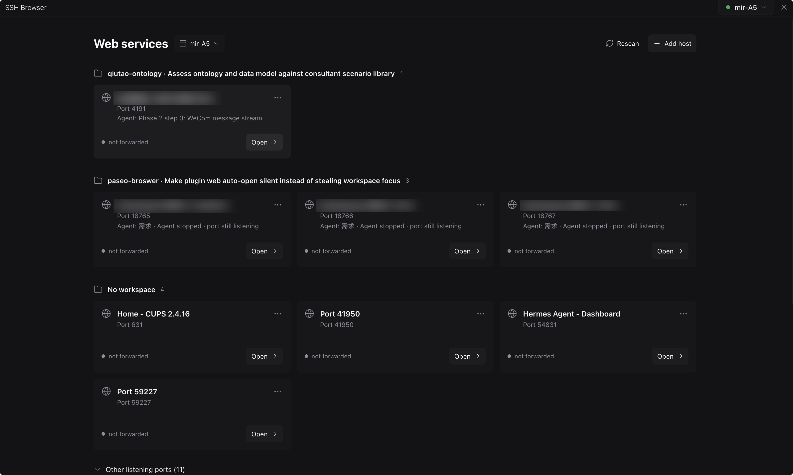
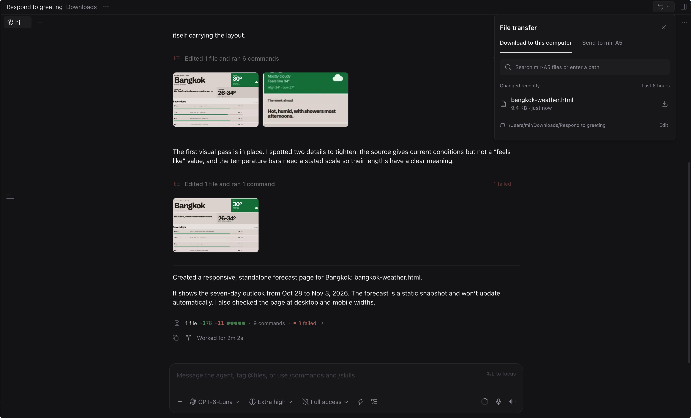
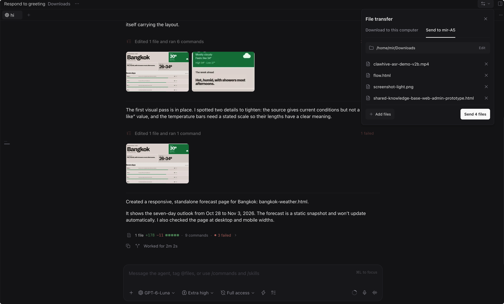

# SSH Browser for Paseo

Preview web apps running on an SSH host in Paseo Desktop, and move files between that host and your computer. SSH Browser creates local SSH forwards for remote services, so you can use the browser, hot reload and DevTools while your code runs remotely.



## Requirements

- Paseo Desktop and both daemons: **0.14.0-beta.1 or later**. Install the same plugin version on your computer's Paseo host and on each remote host.
- The remote host must run Linux with `ss`. Install `curl` there to identify web services and display page titles.
- Your computer must be able to connect to the remote host with `ssh <host>` without an interactive prompt. Hosts connected through a relay also work if they are reachable by SSH.
- Opening pages inside Paseo and choosing local files for transfer require Paseo Desktop.

## Install

Enable plugins in Paseo's **Settings → Plugins**, then install this Git source on both your computer's Paseo host and each remote host:

```text
git:mailwmj/paseo-ssh-browser
```

Alternatively, run the following against each daemon using the Paseo CLI:

```sh
paseo plugin add git:mailwmj/paseo-ssh-browser
```

After updating, reload both copies. Existing agent sessions receive the preview tool when they next reopen, before their next idle prompt. Plugins run as trusted code on their hosts; review the source before installing.

## Preview a remote app

1. Start your web server in a remote workspace.
2. Choose **+ → SSH Browser** in the workspace. Select a detected page, or enter a port or localhost URL, including a path if needed. A single detected workspace page opens automatically.
3. Use the SSH Browser sidebar to see services across hosts, open a page in the system browser, reconnect a forward, or stop forwarding.

SSH hosts connected in Paseo Desktop appear automatically. For a host connected another way, add its SSH address in the SSH Browser sidebar. Expand **Other listening ports** to open a service that was not identified as a web page.

The plugin tries to use the same local port as the remote service; if it is occupied, it chooses another. HTTPS remains HTTPS: the certificate must be trusted and valid for `127.0.0.1`, the local address used for previews.

### Let an agent preview

An agent can call `open_remote_url` with a remote loopback HTTP or HTTPS URL, then open the returned `localUrl` with `browser_new_tab` and inspect the tab with Paseo's browser tools. The tool creates the tunnel; it does not itself open or verify the page. Use only one connected Desktop browser host for this workflow, so the browser tab opens on the computer that created the tunnel. If no eligible desktop or multiple eligible desktops are connected, the request fails. An agent may need to be asked to preview the page; printed URLs are not opened automatically.

## Transfer files

Open **File transfer** from the workspace header, **+** menu, Explorer, or Command Center.

- **Send to host:** choose the destination folder, add files from your computer, and select **Send**. The destination defaults to the workspace folder and is remembered for that workspace.
- **Download to this computer:** select a recently changed workspace file, or enter an explicit remote path beginning with `/`, `~/`, `./`, or `../` and press Enter. Search filters the recent list.

Downloads are saved under `~/Downloads/Paseo/<workspace name>/` by default; change the receive folder in the panel. Transfers show progress and can be cancelled or retried. Existing files are not overwritten: a numbered suffix is added. Folders, drag and drop, and resuming transfers are not supported.





## Privacy and limitations

The local plugin runs SSH commands using your existing SSH configuration and credentials. While a plugin surface is open, it scans remote listening ports and process information every 10 seconds. It probes listeners with HTTP and, if necessary, HTTPS to identify pages; the HTTPS probe does not verify certificates. Forwards listen on local loopback and stop when disconnected or when the plugin stops. Transfers stream through SSH and do not go through the agent.

Recent preview addresses are stored in local Paseo plugin settings and can include sensitive query parameters; clear them from the workspace panel when needed. The plugin uses some Paseo Desktop internals to find hosts and communicate between plugin copies, so a future Paseo update may break these features. See [OVERVIEW.md](OVERVIEW.md) for more detail.

## Development

```sh
npm install
npm run typecheck
npm test
```

The test suite includes an SSH integration test when `ssh localhost` works without a prompt.

## License

[MIT](LICENSE)
